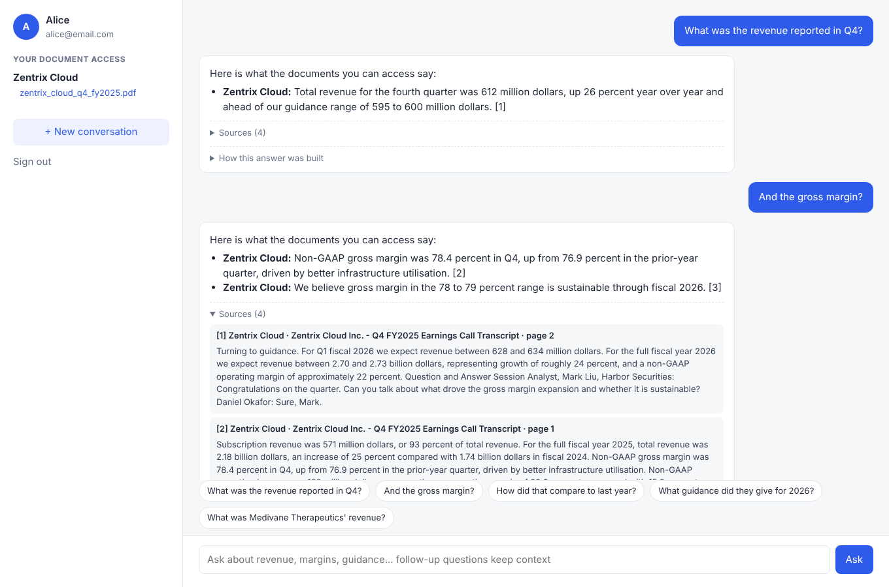
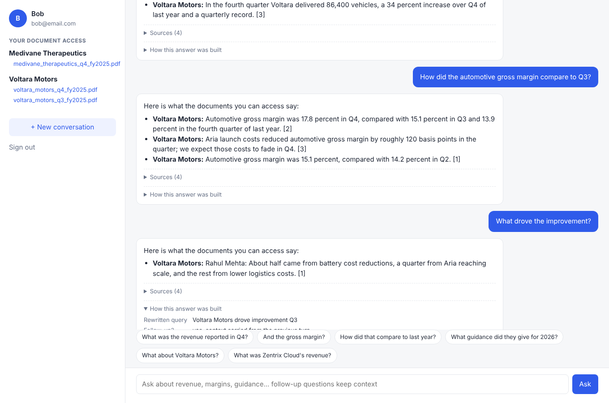

# Multi-User Document Search and Q&A

A Python web app for searching earnings-call PDFs. Several users share one document set, but each user only gets answers from the companies they have access to. Follow-up questions keep the context of the conversation.



- **Backend:** Python, FastAPI
- **UI:** plain HTML/JS page served by the same app
- **Search:** BM25 keyword search, filtered by the user's access
- **Answers:** the most relevant sentences from the PDFs, with page references

See also: [docs/ARCHITECTURE.md](docs/ARCHITECTURE.md) and [docs/REVIEWER_WALKTHROUGH.md](docs/REVIEWER_WALKTHROUGH.md).

## Setup

Requires Python 3.10+.

```bash
git clone https://github.com/mehuldas13/Quantiphi-Assignment.git
cd Quantiphi-Assignment
./run.sh        # macOS / Linux
run.bat         # Windows
```

Open **http://127.0.0.1:8000** and keep the terminal running.

Manual setup:

```bash
python3 -m venv .venv
source .venv/bin/activate          # Windows: .venv\Scripts\activate
pip install -r requirements.txt
python -m uvicorn app.main:app --reload
```

### Troubleshooting

| Problem | Fix |
|---|---|
| `No module named 'app'` | Run the command from the project folder |
| Syntax or type errors on start | Use Python 3.10 or newer |
| Port 8000 in use | `PORT=8001 ./run.sh`, then open port 8001 |
| Browser can't reach the page | Check the terminal; the server must be running |

## Demo users and documents

Six PDFs from five companies are in `data/pdfs/`. The companies and figures are fictional, so the PDFs can be included in a public repo.

| User | Email | Access |
|---|---|---|
| Alice | `alice@email.com` | Zentrix Cloud (Company A) |
| Bob | `bob@email.com` | Voltara Motors (B), Medivane Therapeutics (C) |
| Charlie | `charlie@email.com` | Solvane Energy (D), Brightmart Retail (E) |
| User A | `userA@email.com` | Zentrix Cloud |
| User B | `userB@email.com` | Voltara Motors |
| User C | `userC@email.com` | Zentrix Cloud, Voltara Motors |

Voltara Motors has Q3 and Q4 transcripts; the others have Q4. Access rules are in [`data/access_control.json`](data/access_control.json).

## Using the app

1. Pick a user on the login screen. The left panel shows the documents that user can access.
2. Ask a question, e.g. "What was the revenue reported in Q4?".
3. Ask a follow-up, e.g. "And the gross margin?".
4. Expand **Sources** to see the excerpts used, and **How this answer was built** to see the rewritten query and which companies were searched.
5. Ask about a company the user can't access to see the access-denied response.

Each browser tab has its own session, so you can sign in as different users in different tabs.

| Access denied | Follow-up questions |
|---|---|
|  |  |

## Requirements coverage

| Requirement | Implementation |
|---|---|
| Earnings-call PDFs from 4–5 companies | `data/pdfs/` (5 companies, 6 PDFs) |
| Users with access to one or two companies | `data/access_control.json` |
| Retrieve relevant excerpts | `app/retriever.py`, `app/answer.py` |
| Follow-ups keep context | `app/contextualizer.py`, `app/memory.py` |
| Users can't see others' documents | Search is filtered by the user's companies (`app/retriever.py`, `app/service.py`) |
| UI: log in, ask, follow up | `app/static/` |
| Multiple users at the same time | `tests/test_concurrency.py`, `scripts/concurrency_demo.py` |

## Project structure

```
app/
  main.py            API endpoints, serves the UI
  service.py         Q&A pipeline
  access.py          Access rules
  auth.py            Login and tokens
  ingest.py          PDF loading and chunking
  retriever.py       BM25 search
  contextualizer.py  Follow-up handling
  memory.py          Conversation history
  answer.py          Answer generation
  text.py            Tokenizer and synonyms
  config.py          Settings
  static/            Web UI
data/
  access_control.json
  pdfs/
scripts/             Sample PDF generator, concurrency demo
tests/
docs/
```

## Tests

```bash
pytest -q
```

The tests check that users only get results from their own companies, that follow-ups keep context, and that parallel users don't affect each other.

With the app running, `python scripts/concurrency_demo.py` sends questions from six users in parallel and reports any leaks.

## API (Swagger)

Swagger is at **http://127.0.0.1:8000/docs**.

1. Call `POST /api/login` with `{"email": "alice@email.com"}` and copy the `token` and `conversation_id`.
2. Click **Authorize** and paste the token (without `Bearer`).
3. Call `POST /api/chat` with `{"question": "What was the revenue reported in Q4?", "conversation_id": "..."}`.

Screenshots are in the [reviewer walkthrough](docs/REVIEWER_WALKTHROUGH.md#7-api-in-swagger).

## Adding PDFs

1. Copy the PDF into `data/pdfs/`.
2. Add it under a company in `data/access_control.json` (or add a new company with its name and aliases).
3. Add the company to the users who should see it.
4. Restart the app.
