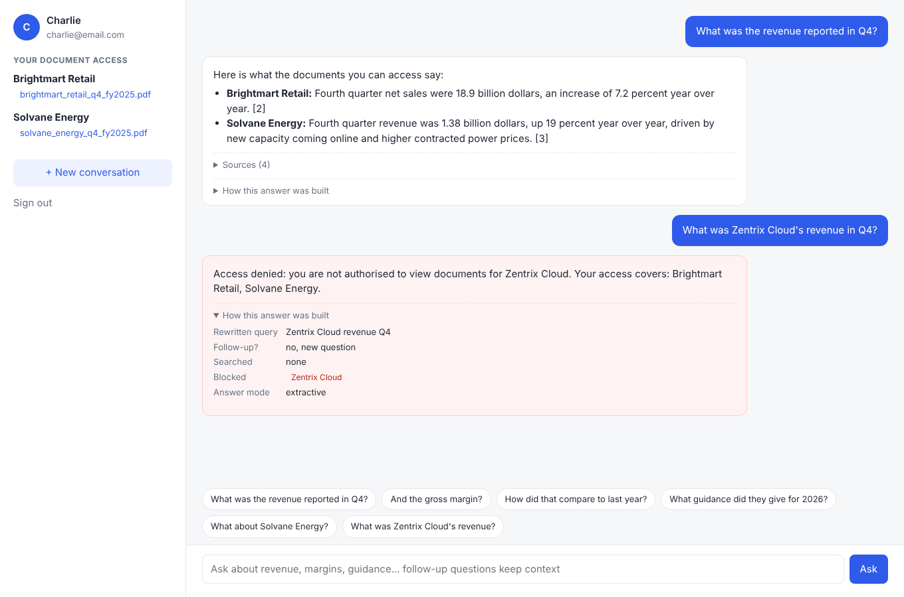
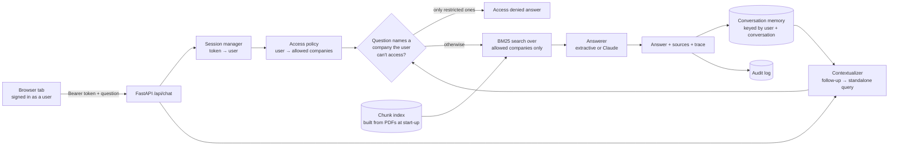

# Multi-User Document Search and Conversational Q&A

A Python web app where several users search a shared set of earnings-call PDFs, and each user only gets answers from the companies they are allowed to see. Follow-up questions keep the context of the conversation ("And the gross margin?" → "How did that compare to Q3?").

It runs on a laptop with **no API key, no database and no model download**. One command starts it, and the browser UI is at `http://localhost:8000`.

| | |
|---|---|
| **Language** | Python 3.10+ |
| **UI** | Web page (HTML + vanilla JS) served by the same FastAPI app |
| **Search** | BM25 keyword search with a per-user access filter |
| **Answers** | Extractive (quotes the best sentences, offline) or Claude (optional, set `ANTHROPIC_API_KEY`) |
| **Tests** | 108 automated tests, including isolation and parallel-user tests |


---

## Contents

1. [Quick start](#1-quick-start)
2. [Demo users and documents](#2-demo-users-and-documents)
3. [Using the app](#3-using-the-app)
4. [How it meets each requirement](#4-how-it-meets-each-requirement)
5. [How it works (short version)](#5-how-it-works-short-version)
6. [Project structure](#6-project-structure)
7. [Running the tests](#7-running-the-tests)
8. [Configuration](#8-configuration)
9. [Using your own PDFs](#9-using-your-own-pdfs)
10. [Limitations and next steps](#10-limitations-and-next-steps)

More detail: [docs/ARCHITECTURE.md](docs/ARCHITECTURE.md) (design and security model) and [docs/DEMO_SCRIPT.md](docs/DEMO_SCRIPT.md) (a step-by-step script for the live demo or video).

---

## 1. Quick start

**macOS / Linux**

```bash
git clone <your-repo-url> doc-qa && cd doc-qa
./run.sh
```

**Windows**

```bat
git clone <your-repo-url> doc-qa && cd doc-qa
run.bat
```

Then open **http://127.0.0.1:8000** (or http://localhost:8000) in your browser.

> Run the command from inside the project folder (the one with `app/` and `run.sh`), and keep that terminal open while you use the app. Don't open `index.html` directly from disk; the page needs the running server. If the terminal shows `http://0.0.0.0:8000`, use `127.0.0.1` in the browser instead.

### Troubleshooting

| Symptom | Fix |
|---|---|
| `ModuleNotFoundError: No module named 'app'` | You're not in the project folder. `cd` into it (where `app/` is) and run again |
| `TypeError: unsupported operand type(s) for \|` or other syntax errors | Python is older than 3.10. Install 3.10+ and recreate `.venv` |
| `address already in use` / port 8000 busy | Another program uses the port: `PORT=8001 ./run.sh` (or `uvicorn app.main:app --port 8001`) and open :8001 |
| Browser says "can't reach this page" | The server isn't running or stopped with an error: check the terminal output |
| `uvicorn: command not found` | Activate the virtualenv first (`source .venv/bin/activate`, Windows `.venv\Scripts\activate`) or use `python -m uvicorn app.main:app` |
| Page opens but is blank or login fails | Hard refresh (Ctrl+Shift+R); check the terminal for errors |

`run.sh` / `run.bat` create a virtual environment, install `requirements.txt`, and start the server. To do it by hand:

```bash
python3 -m venv .venv
source .venv/bin/activate            # Windows: .venv\Scripts\activate
pip install -r requirements.txt
python -m uvicorn app.main:app --reload   # http://127.0.0.1:8000
```

The interactive API docs (Swagger) are at **http://localhost:8000/docs**.

### Optional: Claude-written answers

By default answers are **extractive**: the app quotes the most relevant sentences from the PDFs, with citations. To have Claude write a fluent answer from the same retrieved excerpts:

```bash
export ANTHROPIC_API_KEY=sk-ant-...     # Windows: set ANTHROPIC_API_KEY=...
uvicorn app.main:app
```

Claude only ever receives excerpts that already passed the user's access filter, so it cannot leak a restricted document. If the API is unreachable, the app falls back to extractive answers automatically.

---

## 2. Demo users and documents

The dataset is five companies' earnings-call transcripts (six PDFs) in `data/pdfs/`.

> **The companies and figures are fictional**, generated by `scripts/generate_sample_pdfs.py`, so the repo can be public without copyright questions. They follow the layout of a real call (operator intro, CEO remarks, CFO financial review, analyst Q&A), so the search behaves as it would on real transcripts. See [section 9](#9-using-your-own-pdfs) to swap in real earnings-call PDFs.

| Company (label in the assignment) | Sector | Documents |
|---|---|---|
| **Zentrix Cloud** (Company A / X) | Cloud software | Q4 FY2025 |
| **Voltara Motors** (Company B / Y) | Electric vehicles | Q4 FY2025, Q3 FY2025 |
| **Medivane Therapeutics** (Company C) | Pharma | Q4 FY2025 |
| **Solvane Energy** (Company D) | Renewable energy | Q4 FY2025 |
| **Brightmart Retail** (Company E) | Retail | Q4 FY2025 |

Users, exactly as in the assignment's two examples:

| User | Email | Can access |
|---|---|---|
| Alice | `alice@email.com` | Zentrix Cloud (A) |
| Bob | `bob@email.com` | Voltara Motors (B), Medivane Therapeutics (C) |
| Charlie | `charlie@email.com` | Solvane Energy (D), Brightmart Retail (E) |
| User A | `userA@email.com` | Zentrix Cloud (X) |
| User B | `userB@email.com` | Voltara Motors (Y) |
| User C | `userC@email.com` | Zentrix Cloud (X), Voltara Motors (Y) |

All of this lives in one file, [`data/access_control.json`](data/access_control.json). Edit it and restart to change who sees what.

---

## 3. Using the app

1. **Sign in.** Click a demo user card, or type an email. Unknown emails are rejected.
2. **Look at the left panel.** It lists the companies and PDFs this user can access. Clicking a PDF opens it; the server checks access for every download.
3. **Ask a question**, or click one of the suggested questions under the chat.
4. **Ask a follow-up** such as "And the gross margin?" or "How did that compare to Q3?". The app reuses the company, topic and period from earlier in the conversation.
5. **Open "Sources"** under an answer to see the exact excerpts used, with company, document and page.
6. **Open "How this answer was built"** to see the rewritten standalone query, whether the question was treated as a follow-up, which companies were searched, and which were blocked.
7. **Ask about a company you can't see**, for example "What was Zentrix Cloud's revenue?" as Charlie. You get an access-denied answer and no excerpts.
8. **New conversation** clears the context. **Sign out** ends the session.

**Showing several users at once:** the session is stored per browser tab, so you can open two or three tabs, sign in as different users, and use them side by side.

| Access denied for a restricted company | Bob's follow-up questions on Company B |
|---|---|
|  |  |

---

## 4. How it meets each requirement

| Requirement from the assignment | Where and how | How to see it |
|---|---|---|
| Earnings-call PDFs from 4–5 companies | 6 PDFs from 5 companies in `data/pdfs/` | Left panel after sign-in |
| Dummy-email users with access to one or two companies | `data/access_control.json`; Alice, Bob, Charlie and User A/B/C as in the assignment | Login screen lists each user's access |
| Query and retrieve relevant excerpts | `app/retriever.py` (BM25 search) and `app/answer.py` | Ask "What was the revenue reported in Q4?" and open "Sources" |
| Conversational: follow-ups keep context | `app/contextualizer.py` rewrites follow-ups using the user's conversation, stored in `app/memory.py` | "And the gross margin?" then "How did that compare to last year?" |
| Isolation: users never see other users' documents | Access filter applied **before** search (`app/retriever.py`), re-checked after (`app/service.py`), on downloads (`app/main.py`), and conversations keyed by user (`app/memory.py`) | Ask about a company you don't own; `tests/test_access_control.py` |
| Basic UI: log in with email | Login screen, `app/static/` | Open http://localhost:8000 |
| Basic UI: submit queries, view answers | Chat panel with sources | Ask anything |
| Basic UI: context-aware follow-ups | "How this answer was built" panel shows the rewritten query | Expand it under a follow-up answer |
| Simultaneous users that don't interfere | FastAPI thread pool; read-only index; locks on sessions, conversations and the audit log | Two browser tabs, `scripts/concurrency_demo.py`, `tests/test_concurrency.py` |
| Simulated authentication | Random bearer token per login (`app/auth.py`) | `/api/login` in http://localhost:8000/docs |
| Python, sample PDFs, README setup guide | This repository | You're reading it |

**The example scenario from the assignment** works as written:

* **Alice** asks "What was the revenue reported in Q4?" and gets *"Total revenue for the fourth quarter was 612 million dollars, up 26 percent…"* from Zentrix Cloud only.
* **Bob** asks "What was Voltara's revenue in Q4?" → *4.12 billion dollars*, then "How did the automotive gross margin compare to Q3?" → *17.8 percent in Q4, compared with 15.1 percent in Q3*, then "What drove the improvement?" → *battery cost reductions, Aria reaching scale, lower logistics costs*.
* **Charlie** asks about Zentrix Cloud (A) or Voltara Motors (B) and gets *"Access denied: you are not authorised to view documents for…"* with no excerpts.

These three flows are automated in `tests/test_conversation.py` and `tests/test_access_control.py`.

---

## 5. How it works (short version)



1. **Start-up:** every PDF named in `access_control.json` is read with `pypdf`, split into sentences, grouped into ~90-word overlapping chunks, and tagged with its company. A question at the bottom of a page is kept with the answer at the top of the next.
2. **Sign-in:** the email is checked against the policy and a random token is issued. All later calls identify the user **only** from that token.
3. **Each question:**
   1. Look up the user's allowed companies.
   2. Rewrite follow-ups into a standalone query by carrying over the *company*, *topic* and *period* from the previous turn.
   3. If the question names companies the user can't access, refuse those.
   4. Search with BM25, scoring **only** chunks from allowed companies.
   5. Build the answer from those chunks (extractive, or Claude if a key is set).
   6. Save the turn in this user's conversation and write an audit-log line.

Full explanation, including the security model and design trade-offs: **[docs/ARCHITECTURE.md](docs/ARCHITECTURE.md)**.

---

## 6. Project structure

```
doc-qa/
├── app/
│   ├── main.py            FastAPI app: API endpoints + serves the UI
│   ├── service.py         The Q&A pipeline (the 6 steps above)
│   ├── access.py          Access policy: users → companies → documents
│   ├── auth.py            Simulated login, bearer tokens
│   ├── ingest.py          PDF → text → sentence-aware chunks
│   ├── retriever.py       BM25 search with the access pre-filter
│   ├── contextualizer.py  Follow-up question → standalone query
│   ├── memory.py          Per-user conversation store
│   ├── answer.py          Extractive and Claude answer generators
│   ├── text.py            Tokeniser, stop words, finance synonyms
│   ├── config.py          Settings (env-var overridable)
│   └── static/            The web UI (index.html, app.js, style.css)
├── data/
│   ├── access_control.json  Who can see what
│   └── pdfs/                Sample earnings-call PDFs
├── scripts/
│   ├── concurrency_demo.py    Hit the running server with 6 users in parallel
│   ├── generate_sample_pdfs.py  Rebuild the sample PDFs
│   └── transcripts.py           Text of the sample transcripts
├── tests/                 pytest suite (isolation, conversation, concurrency)
├── docs/                  Architecture, demo script, screenshots
├── logs/audit.jsonl       Created at runtime: one line per question
├── requirements.txt
└── run.sh / run.bat
```

---

## 7. Running the tests

```bash
source .venv/bin/activate
pytest -q
```

Expected: `108 passed`. What they cover:

| File | Checks |
|---|---|
| `tests/test_access_control.py` | Policy matches the assignment; for every user × 15 questions (including ones naming other companies), no excerpt from another company is ever returned; Charlie can't see A or B; mixed questions are partly blocked; PDF download is authorised; login is required; one user can't read or write another user's conversation |
| `tests/test_conversation.py` | Alice's Q4 revenue → gross margin flow; Bob's Voltara Q4 → Q3 comparison → "what drove the improvement"; switching company keeps the topic; a new conversation has no memory; a follow-up can't reach a restricted company through history |
| `tests/test_concurrency.py` | 18 sessions (6 users × 3) asking 90 questions in parallel; every answer stays within that user's companies and every conversation contains exactly its own turns |

With the server running you can also show concurrency live:

```bash
python scripts/concurrency_demo.py
# ... 6 users x 3 questions in parallel, 0.11s, leaks: 0
```

---

## 8. Configuration

All settings are optional environment variables (see `app/config.py`).

| Variable | Default | Meaning |
|---|---|---|
| `DOCQA_ANSWER_MODE` | `auto` | `extractive`, `claude`, or `auto` (Claude if `ANTHROPIC_API_KEY` is set) |
| `ANTHROPIC_API_KEY` | unset | Enables Claude answers |
| `DOCQA_CLAUDE_MODEL` | `claude-opus-5-5` | Claude model used in Claude mode |
| `DOCQA_TOP_K` | `4` | Excerpts retrieved per question |
| `DOCQA_CHUNK_WORDS` | `90` | Target chunk size in words |
| `DOCQA_OVERLAP_SENTENCES` | `1` | Sentences shared by neighbouring chunks |
| `DOCQA_MAX_HISTORY_TURNS` | `10` | Turns kept per conversation |
| `DOCQA_PDF_DIR`, `DOCQA_ACCESS_FILE`, `DOCQA_LOG_DIR` | `data/pdfs`, `data/access_control.json`, `logs` | File locations |

---

## 9. Using your own PDFs

To use real earnings-call PDFs (for example from a company's investor-relations site):

1. Copy the PDFs into `data/pdfs/`.
2. Add the company and file names to `data/access_control.json`:
   ```json
   "acme": {
     "name": "Acme Corp",
     "aliases": ["acme", "acme corp"],
     "documents": ["acme_q4_2025_call.pdf"]
   }
   ```
   `aliases` are the names people will type in questions; they're used to detect questions about a restricted company.
3. Grant it to users: `"alice@email.com": {"name": "Alice", "companies": ["zentrix_cloud", "acme"]}`.
4. Restart the server.

A PDF that isn't listed under a company is never indexed, so nothing becomes searchable without an owner. Scanned (image-only) PDFs need OCR first, since `pypdf` reads only the text layer.

---

## 10. Limitations and next steps

This is a demo-sized system. What would change for production:

| Today | Production |
|---|---|
| Simulated login with dummy emails | SSO / OAuth2 (e.g. Google, Okta, Entra ID), roles and groups in a database |
| In-memory sessions and conversations (lost on restart) | Redis or a database, so several server instances can share them |
| BM25 keyword search | Hybrid search: BM25 + vector embeddings in a store with metadata filtering (pgvector, OpenSearch, Vertex AI Vector Search), plus a re-ranker |
| Rule-based follow-up rewriting | LLM query rewriting (already uses Claude for answers when a key is set) |
| Index built at start-up | Ingestion pipeline with OCR, table extraction and incremental updates |
| JSONL audit log | Central logging and monitoring |

See [docs/ARCHITECTURE.md](docs/ARCHITECTURE.md#7-production-roadmap) for more.
