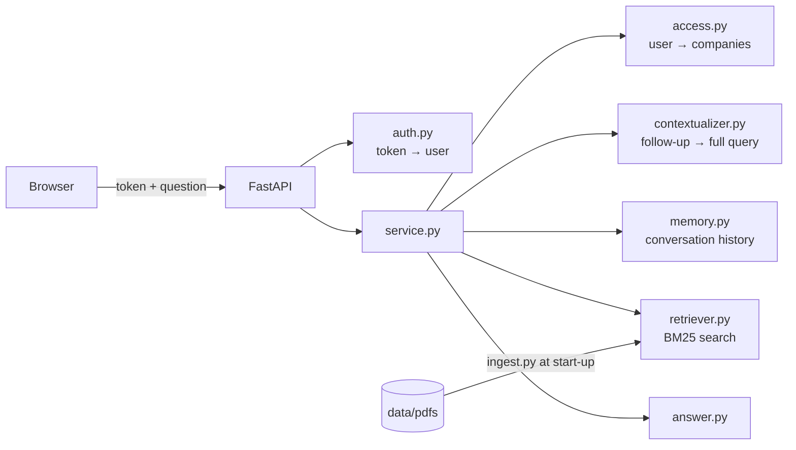

# Architecture

## Components

| Module | Purpose |
|---|---|
| `access.py` | Loads `access_control.json`: which companies each user can see, and which documents belong to each company |
| `auth.py` | Login with an email, returns a random token. Every request identifies the user from this token |
| `ingest.py` | Reads the PDFs and splits them into ~90-word chunks tagged with company and page |
| `retriever.py` | BM25 search over the chunks of the user's companies only |
| `contextualizer.py` | Turns a follow-up into a full query using the previous turn |
| `memory.py` | Conversation history, stored per user and conversation |
| `answer.py` | Picks the most relevant sentences from the retrieved chunks |
| `service.py` | Runs the steps below for each question |

## Handling a question

1. Get the user from the token and look up their companies.
2. If it's a follow-up, fill in the missing company, topic or period from the previous turn.
3. If the question names a company the user can't access, return an access-denied message for it.
4. Search only the chunks belonging to the user's companies.
5. Build the answer from the top chunks and return it with its sources.
6. Save the turn to the user's conversation and write a line to `logs/audit.jsonl`.

## Access control

- The user always comes from the login token, never from the request body.
- The search only looks at chunks from the user's companies, so other documents can't appear in results.
- Each result is checked against the access rules again before it's returned.
- Conversations are stored under the user's email, so one user can't read or continue another's conversation.
- PDF downloads (`/api/documents/{name}`) check access too.
- Only PDFs listed in `access_control.json` are indexed.

## Follow-up questions

Each turn records three values: **company**, **topic** and **period**. When a question is a follow-up (for example it starts with "and" or "what about", uses "that" or "it", or has no company), the missing values are taken from the previous turn.

| Question | Company | Topic | Period |
|---|---|---|---|
| What was Voltara's revenue in Q4? | Voltara | revenue | Q4 |
| How did the automotive gross margin compare to Q3? | Voltara *(kept)* | automotive gross margin | Q3 |
| What drove the improvement? | Voltara *(kept)* | drove improvement | Q3 *(kept)* |
| What about Medivane? | Medivane | drove improvement *(kept)* | Q3 *(kept)* |

The company is used as a search filter. The topic and period are the search terms. The UI shows the resulting query under "How this answer was built".

## Search and answers

- **Chunking:** sentences are grouped into ~90-word chunks with one sentence of overlap. An analyst's question is kept in the same chunk as the answer to it.
- **Search:** BM25 with simple stemming and a short list of finance synonyms (Q4 → fourth quarter, revenue ↔ sales).
- **Answer:** the sentences that best match the query terms, preferring ones with numbers. When a matching sentence is an analyst's question, the next sentence (the answer) is used. Up to three sentences are returned, each with its company and source number.

## Concurrency

FastAPI runs requests in a thread pool. The search index and access rules are read-only after start-up. Sessions, conversations and the audit log are each protected by a lock. `tests/test_concurrency.py` runs 18 sessions in parallel and checks that results and conversations stay separate.
