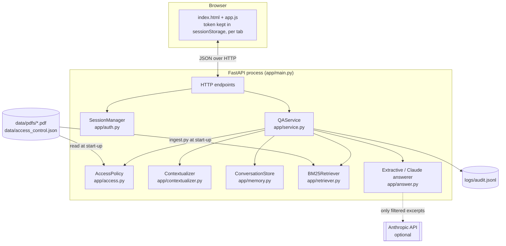
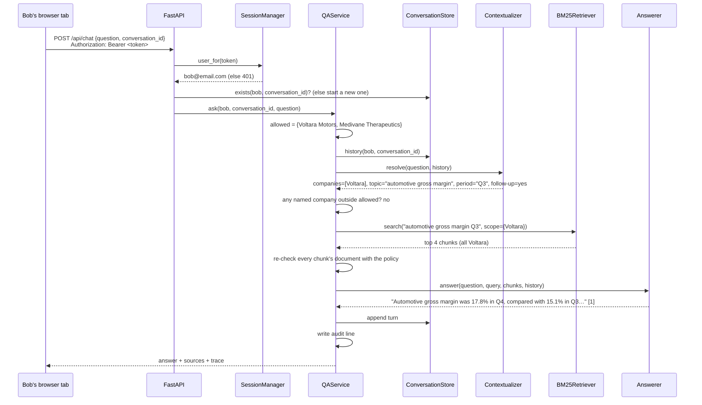

# Architecture

This document explains how the system is put together and why, so that anyone on the team can explain it or extend it. The [README](../README.md) covers setup and usage.

## 1. The problem in one paragraph

Several users query one shared pile of documents. Each user is entitled to a subset (by company). They must get relevant excerpts from **their** subset only, be able to ask follow-up questions that rely on earlier turns, and use the system at the same time as other users without their questions, answers or conversations mixing.

## 2. Components

| Module | Responsibility | Shared state | Thread safety |
|---|---|---|---|
| `access.py` | Loads the policy; answers "which companies may this user read?", "who owns this PDF?", "which companies does this text mention?" | Policy (read-only) | Immutable after start-up |
| `auth.py` | Login with a demo email → random token; token → user | Token table | `threading.Lock` |
| `ingest.py` | PDF → text per page → sentences → ~90-word overlapping chunks, each tagged with company, document, title, page | None | Runs once at start-up |
| `retriever.py` | BM25 ranking over chunks, **restricted to allowed companies** | Index (read-only) | Immutable after start-up |
| `contextualizer.py` | Turns a follow-up into a standalone query using the previous turn | None (pure function) | Stateless |
| `memory.py` | Conversation history per (user, conversation id) | Conversation table | `threading.Lock` |
| `answer.py` | Builds the answer from retrieved chunks: extractive, or Claude | None | Stateless (the Anthropic client is thread-safe) |
| `service.py` | Runs the pipeline; writes the audit log | Audit file | `threading.Lock` |
| `main.py` | HTTP API, auth dependency, static UI | Holds the singletons | FastAPI runs `def` endpoints in a thread pool |

## 3. Request lifecycle

What happens when Bob, mid-conversation, asks **"How did the automotive gross margin compare to Q3?"**

## 4. Security model: how isolation is guaranteed

Isolation is enforced by code, in several independent layers. None of them depends on the language model "behaving".

| # | Layer | Where | What it prevents |
|---|---|---|---|
| 1 | **Identity comes from the token only** | `main.py: current_user` | A client can't claim to be someone else by sending an email or user id in the request body |
| 2 | **Pre-filter before search** | `retriever.py: search(query, allowed_companies)` | Chunks from other companies are never scored, so they can't be ranked, returned or quoted. This is the main control |
| 3 | **Explicit refusal for named restricted companies** | `service.py` step 3 | "What was Zentrix's revenue?" from Charlie gets a clear access-denied answer instead of a confusing answer from his own companies |
| 4 | **Post-filter re-check** | `service.py`: `policy.can_read(...)` on every hit | Defence in depth: even if a future retriever forgot the filter, nothing unauthorised leaves the service |
| 5 | **Conversations keyed by (user, id)** | `memory.py` | Bob can't read or append to Alice's conversation, even with her conversation id (he gets a 404, or a fresh conversation) |
| 6 | **History re-checked every turn** | `service.py` | A follow-up can't inherit a restricted company from history: the carried-over company goes through the same check as a typed one |
| 7 | **Document downloads authorised** | `main.py: /api/documents/{name}` | A user can't open another company's PDF by guessing its file name; path tricks get 403/404 |
| 8 | **LLM sees only filtered excerpts** | `answer.py: ClaudeAnswerer` | In Claude mode the model never receives the corpus, only the user's own excerpts and the user's own history |
| 9 | **Unlisted PDFs are never indexed** | `ingest.py: load_corpus` | A file dropped into the folder without an owner company can't become searchable |
| 10 | **Audit trail** | `logs/audit.jsonl` | Every question records the user, rewritten query, companies searched/blocked and documents returned |

A design note on layer 3: the refusal confirms that a company with that name exists in the system. For earnings calls (public companies) that is fine and makes the demo clearer. If company names themselves were sensitive, remove step 3 and the user would simply get "I couldn't find anything in the documents you have access to."

## 5. Conversational memory

### Why rewrite the question?

Search engines don't know about conversations. "And the gross margin?" contains no company and no period, so searching for it directly would return gross margins from every company the user can see. The fix used by most conversational search systems is **query rewriting**: turn the follow-up into a standalone question first, then search.

### How the rewriting works here

Each turn stores three **slots**:

| Slot | Extracted by | Example |
|---|---|---|
| `companies` | Alias match against the policy (`"voltara"`, `"aria"` → Voltara Motors) | `[voltara_motors]` |
| `period` | Regex: `Q1`–`Q4`, "fourth quarter", "full year", "2026", "next year", "last year" | `Q4` |
| `topic` | Remaining content words after removing company names, periods, stop words and filler like "how about", "compare" | `automotive gross margin` |

A question is a **follow-up** if there is a previous turn and it either starts like one ("and…", "what about…"), refers back ("that", "it", "their"), has no topic of its own, or names no company and is short. For a follow-up, any empty slot is filled from the previous turn.

| Turn | User types | Slots after resolution | Search query |
|---|---|---|---|
| 1 | What was Voltara's revenue in Q4? | Voltara · revenue · Q4 | `revenue Q4` in {Voltara} |
| 2 | How did the automotive gross margin compare to Q3? | Voltara *(carried)* · automotive gross margin · Q3 | `automotive gross margin Q3` in {Voltara} |
| 3 | What drove the improvement? | Voltara *(carried)* · drove improvement · Q3 *(carried)* | `drove improvement Q3` in {Voltara} |
| 4 | What about Medivane? | Medivane · drove improvement *(carried)* · Q3 *(carried)* | … in {Medivane} |

Company names are used as a **filter**, not as search words. That stops the transcript's title and the operator's greeting (which mention the company name in every file) from out-ranking the real answer.

The UI shows all of this under **"How this answer was built"**, so the team can see exactly what the system understood.

### Why rules and not an LLM for rewriting?

* It works with no API key, so the demo runs anywhere.
* It is deterministic, so the tests can assert exact behaviour.
* It is easy to explain.

In Claude mode, the answer model also receives the last four turns of the user's own history, so the wording of the answer handles references like "that" naturally. Swapping the rule-based rewriter for an LLM rewriter is a contained change in `contextualizer.py`.

## 6. Retrieval and answering

### Chunking (`ingest.py`)

* Text is extracted page by page with `pypdf`, cleaned (footer and title removed), and split into sentences.
* Sentences are grouped into chunks of about 90 words, with one sentence of overlap between neighbours so a fact on a boundary isn't lost.
* A chunk never ends on a question: an analyst's question is always kept with the executive's answer, even across a page break.
* Each chunk keeps `company_id`, `document`, `title` and the `page` of its first sentence, for filtering and citations.

### BM25 search (`retriever.py`)

BM25 is the standard keyword-ranking formula used by Elasticsearch and OpenSearch. It was chosen because:

* Earnings-call questions use the same vocabulary as the documents (revenue, margin, guidance, Q4), which is where keyword search is strong.
* It needs no model download, GPU or API key, and builds an index for this corpus in milliseconds.
* It is deterministic, which suits a demo and tests.

Two small additions make it work better for this domain (`text.py`): light stemming (margin/margins) and a finance synonym list (Q4 → "fourth quarter", revenue ↔ sales, guidance ↔ outlook/expect). That is why Brightmart's "net sales" answers a "revenue" question.

The retriever has a one-method interface, `search(query, allowed_companies, k)`. Replacing it with a vector or hybrid store only requires keeping the `allowed_companies` filter, which every serious vector store supports as a metadata filter.

### Answers (`answer.py`)

* **Extractive (default):** scores each sentence of the retrieved chunks by the weight of the query words it contains, boosts sentences with numbers, down-weights operator boilerplate, and when an analyst's question matches, takes the executive's answer that follows it. It returns up to three sentences, each labelled with its company and citation number.
* **Claude (optional):** sends the numbered excerpts plus the user's own last turns to Claude with instructions to answer only from the excerpts and cite them. Uses `claude-opus-5-5` at low effort, with server-side fallback enabled, and falls back to extractive on any API error.

## 7. Concurrency

* Uvicorn serves requests; FastAPI runs the synchronous endpoints in a worker thread pool, so many requests run at once.
* The index and the policy are built once at start-up and only read afterwards. Concurrent reads need no locks.
* Mutable shared state is limited to three places, each behind its own lock: session tokens, conversations, and the audit file.
* Per-request state (the resolved query, hits, answer) lives on the stack of the request's thread, so nothing can bleed between users.
* `tests/test_concurrency.py` runs 18 sessions × 5 questions in parallel and checks every answer and every conversation. `scripts/concurrency_demo.py` does the same against a live server.

To scale beyond one process, move sessions and conversations to Redis or a database (see below). The index can be loaded by each process, or moved to a search service.

## 8. Production roadmap

| Area | Next step |
|---|---|
| Identity | SSO / OAuth2 (OIDC); map identity-provider groups to companies; policy in a database with an admin UI |
| State | Sessions and conversations in Redis/Postgres, so several app instances can run behind a load balancer |
| Search | Hybrid BM25 + embeddings in a vector store with metadata filters (pgvector, OpenSearch, Vertex AI Vector Search, Pinecone), plus a cross-encoder re-ranker |
| Conversation | LLM-based query rewriting; summarised long-term memory |
| Ingestion | Background pipeline with OCR for scanned PDFs, table extraction, incremental re-indexing, document versioning |
| Answers | Streaming responses; answer-quality evaluation set; guardrails for numbers (cite-or-refuse) |
| Operations | Docker image, CI running the test suite, structured logging, metrics, rate limiting |
