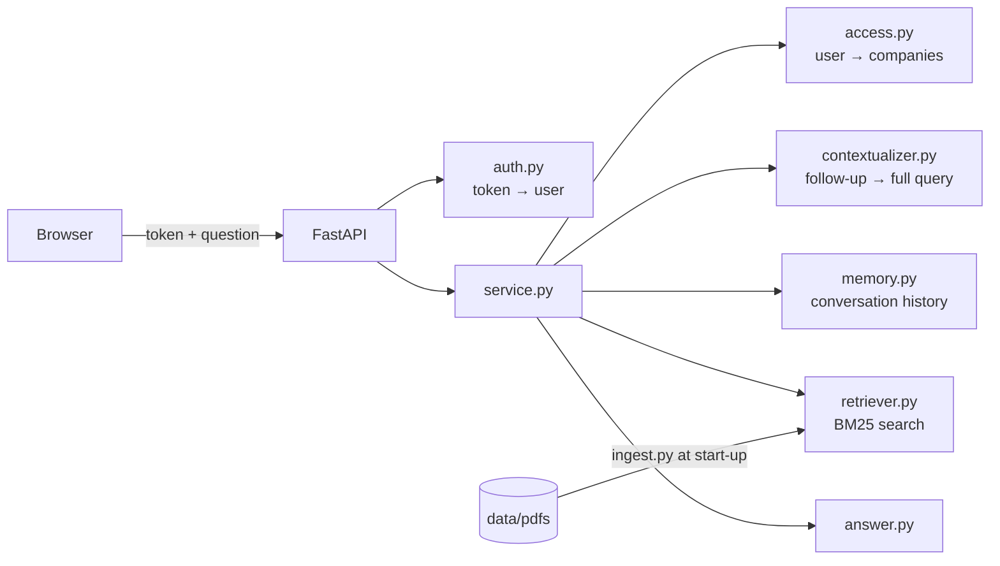

# Architecture

## Components

| Module | Purpose |
|---|---|
| `access.py` | Loads `access_control.json`: user → companies → documents |
| `auth.py` | Email login, issues a random token; requests are identified by token |
| `ingest.py` | Splits PDFs into ~90-word chunks tagged with company and page |
| `retriever.py` | BM25 search restricted to the user's companies |
| `contextualizer.py` | Rewrites follow-ups into full queries |
| `memory.py` | Conversation history per user and conversation |
| `answer.py` | Selects the best-matching sentences |
| `service.py` | Runs the pipeline below |

## Handling a question

1. Token → user → allowed companies.
2. Follow-up? Fill missing company/topic/period from the previous turn.
3. Named company not allowed → access-denied message.
4. BM25 search over the allowed companies' chunks.
5. Answer from the top chunks, with sources.
6. Save the turn; append to `logs/audit.jsonl`.

## Access control

- User identity comes only from the token.
- Search is pre-filtered to the user's companies.
- Results are re-checked against the access rules before returning.
- Conversations are keyed by (user, conversation id).
- `/api/documents/{name}` checks access.
- Only PDFs listed in `access_control.json` are indexed.

## Follow-up questions

Each turn stores **company**, **topic** and **period**. A follow-up (starts with "and"/"what about", uses "that"/"it", or names no company) inherits missing values from the previous turn.

| Question | Company | Topic | Period |
|---|---|---|---|
| What was Voltara's revenue in Q4? | Voltara | revenue | Q4 |
| How did the automotive gross margin compare to Q3? | Voltara *(kept)* | automotive gross margin | Q3 |
| What drove the improvement? | Voltara *(kept)* | drove improvement | Q3 *(kept)* |
| What about Medivane? | Medivane | drove improvement *(kept)* | Q3 *(kept)* |

Company is the search filter; topic and period are the search terms.

## Search and answers

- **Chunking:** ~90 words, one-sentence overlap; an analyst question stays with its answer.
- **Search:** BM25 with light stemming and finance synonyms (Q4 → fourth quarter, revenue ↔ sales).
- **Answer:** up to three best-matching sentences, numbers preferred; a matched analyst question is replaced by the answer that follows it.

## Concurrency

Requests run in FastAPI's thread pool. The index and access rules are read-only after start-up; sessions, conversations and the audit log each have a lock. `tests/test_concurrency.py` checks parallel sessions stay separate.
