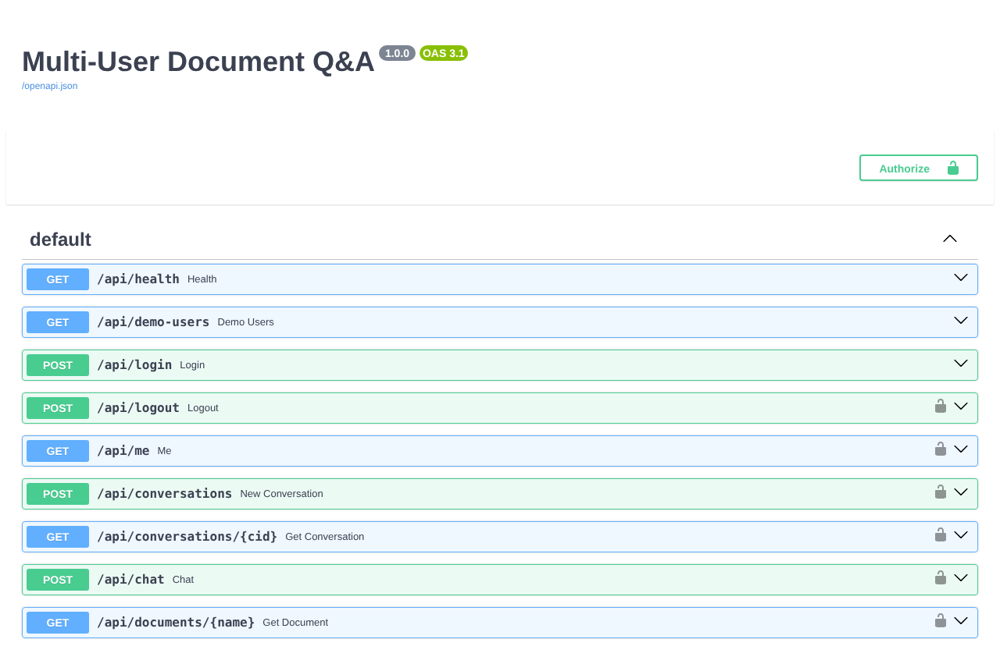
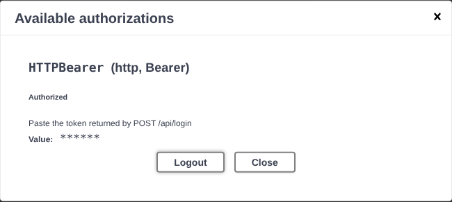

# Reviewer walkthrough (about 10 minutes)

Follow these steps to check the system against the assignment. Each step lists what to do and what you should see. The four points the assignment asks to see are marked:

① logging in as different users · ② submitting queries and getting answers · ③ query isolation · ④ conversational follow-ups

## 0. Start the app

```bash
git clone https://github.com/mehuldas13/Quantiphi-Assignment.git
cd Quantiphi-Assignment
./run.sh          # macOS / Linux
run.bat           # Windows
```

Keep the terminal open and go to **http://127.0.0.1:8000**. If it doesn't start, see the troubleshooting table in the [README](../README.md#troubleshooting).

Open the app in **two browser tabs**. Each tab has its own session, so you can sign in as two users at the same time.

Optional extras:
* Swagger API docs: http://127.0.0.1:8000/docs (log in with `POST /api/login`, then paste the token into the **Authorize** button; see [section 7](#7-testing-the-api-in-swagger-docs) below)
* Audit log: `logs/audit.jsonl` (created after the first question)

## 1. The setup

The login screen lists six demo users and the companies each one can access. They match the assignment:

| User | Can access |
|---|---|
| Alice | Zentrix Cloud (Company A) |
| Bob | Voltara Motors (B), Medivane Therapeutics (C) |
| Charlie | Solvane Energy (D), Brightmart Retail (E) |
| User A / B / C | Zentrix Cloud / Voltara Motors / both |

All access rules live in one file: `data/access_control.json`.

## 2. Alice: login, query, follow-ups ① ② ④

**Tab 1:** click **Alice**. The left panel lists only Zentrix Cloud's transcript.

| Ask | Expected answer | What to check |
|---|---|---|
| What was the revenue reported in Q4? | Total revenue for the fourth quarter was 612 million dollars, up 26 percent… | Open **Sources**: every excerpt is from Zentrix Cloud, with document and page |
| And the gross margin? | Non-GAAP gross margin was 78.4 percent in Q4… | Open **How this answer was built**: Follow-up = yes, rewritten query `gross margin Q4` (Q4 carried over) |
| How did that compare to last year? | …78.4 percent in Q4, up from 76.9 percent in the prior-year quarter… | Topic "gross margin" carried over from the previous turn |

## 3. Alice can't see other companies ③

| Ask | Expected |
|---|---|
| What was Voltara Motors' revenue? | Red **Access denied: you are not authorised to view documents for Voltara Motors. Your access covers: Zentrix Cloud.** No sources |
| Compare Zentrix and Voltara revenue | Zentrix part answered; Voltara listed under **Blocked** in "How this answer was built" |

The search engine only scores chunks from the user's allowed companies, so restricted content can't be retrieved, ranked or quoted.

## 4. Bob at the same time: follow-ups on Company B ① ④

**Tab 2:** sign in as **Bob** while Alice stays signed in on tab 1.

| Ask | Expected answer | What to check |
|---|---|---|
| What was Voltara's revenue in Q4? | 4.12 billion dollars, up 29% | |
| How did the automotive gross margin compare to Q3? | 17.8% in Q4 vs 15.1% in Q3 | Company carried over; uses both the Q4 and the Q3 transcript |
| What drove the improvement? | Battery cost reductions, Aria reaching scale, lower logistics costs | "The improvement" resolved from context |
| What about Medivane? | Answer from Medivane Therapeutics | Company switched, topic kept, still within Bob's access |

Back in **tab 1**, ask Alice **"What are the biggest risks?"**. Her answer still comes from her own conversation and companies; Bob's questions had no effect on it.

## 5. Charlie: the example scenario from the assignment ③

Sign out in tab 2 and sign in as **Charlie**.

| Ask | Expected |
|---|---|
| What was the revenue reported in Q4? | Brightmart 18.9 billion and Solvane 1.38 billion, each labelled with its company |
| What was Zentrix Cloud's revenue in Q4? | Access denied (Company A) |
| What did Voltara say about deliveries? | Access denied (Company B) |

Only Charlie's own PDFs appear in the left panel, and the download endpoint returns 403 for any other company's file.

## 6. Automated checks

In a second terminal, from the project folder:

```bash
source .venv/bin/activate        # Windows: .venv\Scripts\activate
pytest -q
# 108 passed

python scripts/concurrency_demo.py      # needs the app running
# 6 users x 3 questions in parallel, ... leaks: 0
```

* The tests run every user against 15 questions, including ones that name other companies, and check that nothing from another company comes back.
* The concurrency test runs 18 sessions in parallel and checks that every conversation contains only its own turns.

## 7. Testing the API in Swagger (/docs)

Every feature of the UI is also available as a JSON API. Swagger lets you call it from the browser. The app must be running.

**Step 1: open the docs page.** Go to **http://127.0.0.1:8000/docs**. Endpoints with a padlock need a login token. The **Authorize** button is at the top right.



**Step 2: log in.** Expand `POST /api/login`, click **Try it out**, enter the body below and click **Execute**.

```json
{ "email": "alice@email.com" }
```

The response contains a `token` and a `conversation_id`. Copy both.


**Step 3: authorize.** Click **Authorize** at the top of the page. Paste **only the token**, without the word `Bearer`, then click **Authorize**.


The dialog now shows **Authorized**. Click **Close**. Swagger will send the token with every padlocked request.



**Step 4: ask a question.** Expand `POST /api/chat`, click **Try it out**, enter your question and the `conversation_id` from step 2, then click **Execute**.

```json
{
  "question": "What was the revenue reported in Q4?",
  "conversation_id": "<conversation_id from step 2>"
}
```


**Step 5: read the response.** You get code **200** with the `answer`, the `sources` (company, document, page, excerpt) and a `trace` showing the rewritten query and which companies were searched or blocked. Notice the `Authorization: Bearer …` header in the generated curl command.


**Follow-ups and isolation through the API:**
* Send `"question": "And the gross margin?"` with the same `conversation_id` to see context carried over (`trace.is_followup` is `true`).
* Send `"question": "What was Voltara Motors' revenue?"` as Alice: the answer starts with *Access denied* and `sources` is empty.
* To switch user, click **Authorize → Logout**, log in again with another email (step 2) and authorize with the new token.

If you get **401 Not logged in**, the token is missing or expired: repeat steps 2 and 3.
