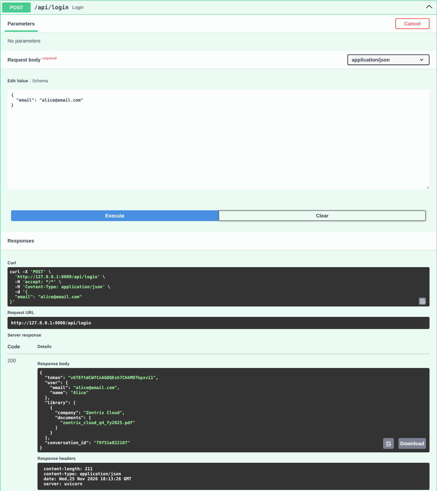
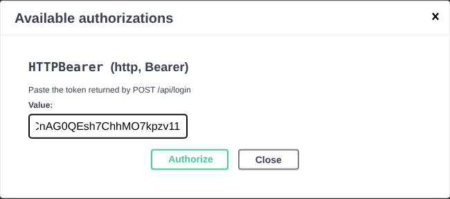
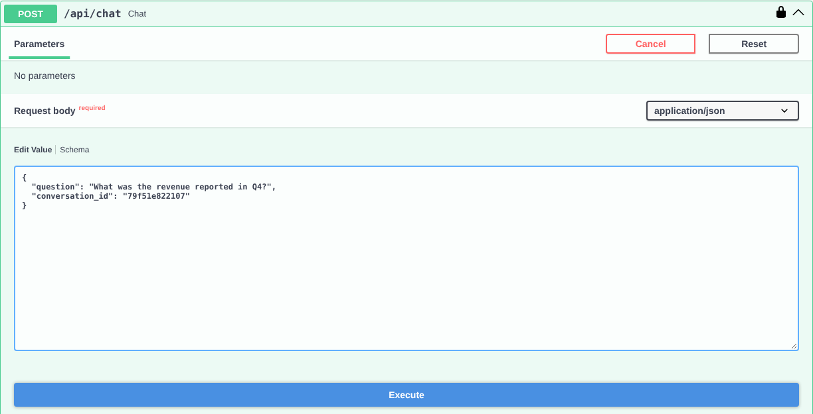
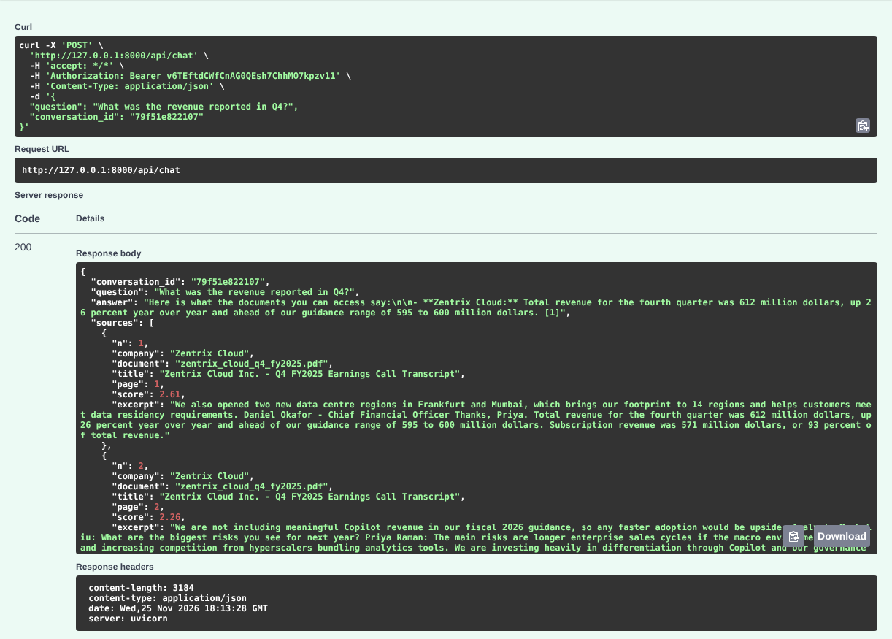

# Reviewer walkthrough

Steps to check the app against the assignment, with the expected results.

① login as different users · ② queries and answers · ③ query isolation · ④ follow-up questions

## 0. Start the app

```bash
git clone https://github.com/mehuldas13/Quantiphi-Assignment.git
cd Quantiphi-Assignment
./run.sh          # macOS / Linux
run.bat           # Windows
```

Open **http://127.0.0.1:8000** in two browser tabs. Each tab has its own session, so you can sign in as two users at once.

## 1. The setup

The login screen lists the demo users and their access:

| User | Can access |
|---|---|
| Alice | Zentrix Cloud (Company A) |
| Bob | Voltara Motors (B), Medivane Therapeutics (C) |
| Charlie | Solvane Energy (D), Brightmart Retail (E) |
| User A / B / C | Zentrix Cloud / Voltara Motors / both |

Access rules are in `data/access_control.json`.

## 2. Alice: login, query, follow-ups ① ② ④

**Tab 1:** click **Alice**. The left panel lists only Zentrix Cloud's transcript.

| Ask | Expected answer | What to check |
|---|---|---|
| What was the revenue reported in Q4? | Total revenue for the fourth quarter was 612 million dollars, up 26 percent… | Open **Sources**: every excerpt is from Zentrix Cloud, with document and page |
| And the gross margin? | Non-GAAP gross margin was 78.4 percent in Q4… | Open **How this answer was built**: Follow-up = yes, rewritten query `gross margin Q4` (Q4 carried over) |
| How did that compare to last year? | …78.4 percent in Q4, up from 76.9 percent in the prior-year quarter… | Topic "gross margin" carried over from the previous turn |

## 3. Alice can't see other companies ③

| Ask | Expected |
|---|---|
| What was Voltara Motors' revenue? | Red **Access denied: you are not authorised to view documents for Voltara Motors. Your access covers: Zentrix Cloud.** No sources |
| Compare Zentrix and Voltara revenue | Zentrix part answered; Voltara listed under **Blocked** in "How this answer was built" |

## 4. Bob at the same time: follow-ups on Company B ① ④

**Tab 2:** sign in as **Bob** while Alice stays signed in on tab 1.

| Ask | Expected answer | What to check |
|---|---|---|
| What was Voltara's revenue in Q4? | 4.12 billion dollars, up 29% | |
| How did the automotive gross margin compare to Q3? | 17.8% in Q4 vs 15.1% in Q3 | Company carried over |
| What drove the improvement? | Battery cost reductions, Aria reaching scale, lower logistics costs | "The improvement" resolved from context |
| What about Medivane? | Answer from Medivane Therapeutics | Company switched, topic kept, still within Bob's access |

Back in tab 1, ask Alice **"What are the biggest risks?"**. The answer comes from Zentrix Cloud only.

## 5. Charlie: the example scenario from the assignment ③

Sign out in tab 2 and sign in as **Charlie**.

| Ask | Expected |
|---|---|
| What was the revenue reported in Q4? | Brightmart 18.9 billion and Solvane 1.38 billion, each labelled with its company |
| What was Zentrix Cloud's revenue in Q4? | Access denied (Company A) |
| What did Voltara say about deliveries? | Access denied (Company B) |

Only Charlie's own PDFs appear in the left panel.

## 6. Automated checks

In a second terminal:

```bash
source .venv/bin/activate        # Windows: .venv\Scripts\activate
pytest -q
# 108 passed

python scripts/concurrency_demo.py      # needs the app running
# 6 users x 3 questions in parallel, ... leaks: 0
```

## 7. API in Swagger

**Step 1.** Open **http://127.0.0.1:8000/docs**. Endpoints with a padlock need a token.


**Step 2.** Expand `POST /api/login`, click **Try it out**, enter the body below and click **Execute**.

```json
{ "email": "alice@email.com" }
```

Copy the `token` and `conversation_id` from the response.



**Step 3.** Click **Authorize**, paste the token (without `Bearer`) and click **Authorize**.



Then click **Close**.


**Step 4.** Expand `POST /api/chat`, click **Try it out**, enter the body below and click **Execute**.

```json
{
  "question": "What was the revenue reported in Q4?",
  "conversation_id": "<conversation_id from step 2>"
}
```



**Step 5.** The response (200) contains the `answer`, its `sources` and a `trace` with the rewritten query.



To switch user, click **Authorize → Logout** and repeat steps 2 and 3 with another email. A **401** means the token is missing or expired.
